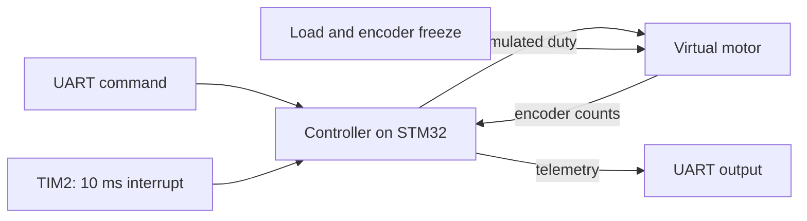

# STM32 Closed-Loop Motor Controller


**Reproduce: `make demo`** · **MCU:** STM32F412 (Cortex-M4F) · **Emulated interfaces:** TIM2 interrupt and USART2; a virtual memory-mapped motor supplies encoder counts and accepts **simulated PWM duty**.

This Embedded C project controls the speed of a simulated motor, responds to load, and safely latches a fault if encoder feedback stops. The plot comes from the running ARM firmware and virtual motor in Renode. The demo is an integration test with assertions, and its [UART](docs/evidence/uart.txt) and [actuator trace](docs/evidence/plant.csv) are included.

## What happened in the demo?

| Event | Measured result |
| --- | --- |
| Reach 1200 RPM | Entered the ±5% band in **810 ms** and stayed there for 300 ms |
| Apply a 600 RPM opposing load | Speed dipped to **930 RPM**; duty rose from about 40% to 60%; band recovery took **910 ms** |
| Freeze encoder feedback | `NO_MOTION` latched and simulated actuator duty reached zero **250.200 ms** after the last encoder advance |
| Clear and explicitly restart | Duty stayed zero until `start`; speed recovered in **1090 ms** |

Recovery times are measured from the start or load event to band entry using 50 ms firmware telemetry. Each speed check requires an uninterrupted 300 ms in band within two seconds. Fault cutoff uses the virtual actuator's timestamps, not UART timing. [All measurements](docs/evidence/metrics.json) include the ARM ELF hash.

## Run it

On Linux x86-64, install Make, a C compiler, Python 3.10+, curl and tar. For example:

```sh
sudo apt-get install build-essential python3-venv curl ca-certificates tar
python3 -m venv .venv
. .venv/bin/activate
pip install -r requirements.txt
./tools/bootstrap.sh
export PATH="$PWD/.tools/xpack-arm-none-eabi-gcc-15.2.1-1.1/bin:$PATH"
export RENODE="$PWD/.tools/renode_1.17.0-portable/renode"
make all        # build/motor.elf
make host-test  # controller C tests with sanitizers
make integration # run ARM firmware and assert the complete scenario
make demo       # run the integration test and generate build/demo.svg
```

The captured run used xPack ARM GCC **15.2.1-1.1**, Renode **1.17.0**, Python **3.14.7**, and matplotlib **3.10.8**. `ARM_GCC`, `RENODE` and `HOST_CC` can select installed tools. Bootstrap checks pinned archive hashes. After a successful demo, `python3 tools/plot.py --snapshot` refreshes the checked-in plot and traces; the plot script verifies the ELF hash first.

## How it works



Every 10 ms, [TIM2_IRQHandler](firmware/main.c#L7) reads the encoder, runs [controller_tick](firmware/controller.c#L31), and writes duty through the [board interface](firmware/board.c). UART parsing and 50 ms telemetry stay outside the interrupt. The integration test checks actuator-write intervals of **9999.900–10000.190 µs** during the running ARM firmware, demonstrating the emulated timer interrupt cadence.

The controller calculates speed from encoder count changes: `RPM = delta_counts × 60 / (240 × 0.010)`. Unsigned subtraction handles counter wraparound. A five-sample average covers 50 ms, smoothing count quantization at the cost of roughly 20 ms delay.

The [PI controller](firmware/controller.c#L15) uses a proportional term to react to the current speed error and an integral term to remove the remaining error under load. Gains are `Kp = 0.025 %/RPM` and `Ki = 0.12 %/(RPM·s)`. Fixed-point arithmetic stores duty as 0–10000, representing 0–100%. Integration pauses when it would push farther into saturation; stopping or entering a fault resets it.

The line-based console accepts `status`, `setpoint <300..2400 RPM>`, `start`, `stop`, and `clear-fault`. Invalid and oversized commands return errors. Changing a setpoint does not start the motor.

The [motor model](renode/MotorPlant.cs) advances in Renode virtual time: its target speed is `max(0, 3000 × duty_fraction − load_rpm)`, with a 200 ms first-order time constant. It integrates speed into encoder counts. A separate switch freezes encoder feedback while the simulated motor continues moving. The model is idealized: there is no electrical motor, current sensing or power stage.

## Walk through the test

1. **Start:** The firmware receives `setpoint 1200` and `start` through USART2. [Command handling](firmware/controller.c#L70) enters RUNNING, then the PI loop reacts to simulated encoder counts. [Startup assertions](tests/integration.py#L62) check zero duty at boot, changing feedback and 300 ms in the target band.
2. **Load:** The virtual peripheral applies a 600 RPM opposing load. Lower encoder increments tell the MCU that speed has dropped, so PI increases simulated duty. [Load assertions](tests/integration.py#L72) check the dip, duty increase and recovery.
3. **Fault:** The simulated encoder stops reporting movement. When duty is at least 20% and no count has advanced for 250 ms, [the MCU latches `NO_MOTION`](firmware/controller.c#L50) and writes zero duty in the same interrupt. [Fault assertions](tests/integration.py#L88) measure the zero write at the simulated actuator within 260 ms of the last count.

The test then restores feedback and proves that `start` is rejected while the fault is latched. `clear-fault` returns to STOPPED with zero duty; only a subsequent `start` enables control again. [Restart assertions](tests/integration.py#L104) check the latch, zero-duty interval and recovery. A stalled motor and disconnected encoder have the same symptom to this controller.

The state machine, commands, PI calculation and TIM2 handler execute on the emulated MCU. The motor dynamics, load and encoder disconnect are simulated by the peripheral. The [host C tests](tests/test_controller.c) cover command bounds, encoder wraparound, PI saturation and fault transitions. Validation is in emulation: no physical board, motor, electrical PWM waveform or real-world timing has been tested. MIT licensed.

## Try it yourself

In [tests/integration.py](tests/integration.py), change `DEMO_LOAD_RPM` from `600` to `300` and run `make demo`. Predict a smaller speed dip and a final loaded duty near **50%** instead of **60%**: the model needs roughly `(1200 + 300) / 3000` duty to hold the target. The test adjusts its load and duty-increase checks to the chosen value; inspect `build/demo.svg` and `build/metrics.json` to check your prediction. Restore `600` and run `make demo` again to return to the published scenario.
