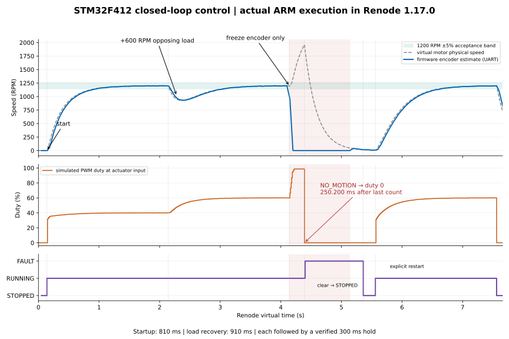
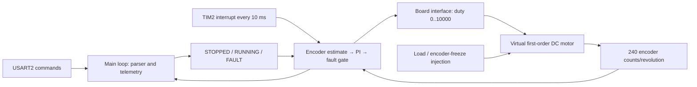

# STM32 Closed-Loop Motor Controller with Fault Injection



**Reproduce this plot: `make demo`. MCU: STM32F412, Cortex-M4F in Renode 1.17.0.** The running ARM ELF uses an emulated TIM2 interrupt and USART2 console. A memory-mapped virtual motor accepts **simulated PWM duty** and returns encoder counts. Native PWM is excluded from the application after a reproducible zero-duty failure described below.

This project demonstrates fixed-point PI speed control, disturbance rejection, bounded command parsing and a latched loss-of-motion fault. The main demo is an asserted integration test, not a prerecorded animation or a host replacement for the controller. Every plotted sample comes from [captured firmware UART output](docs/evidence/uart.txt) or the [motor's actuator/feedback trace](docs/evidence/plant.csv).

## Measured results

| Check | Captured result | Acceptance |
| --- | --- | --- |
| Startup at 1200 RPM | Band entered after **810 ms**; 300 ms hold complete at **1110 ms** | ±5% for 300 ms within 2 s |
| Load disturbance | Speed minimum **930 RPM**; duty rises from about **40% to 60%** | Speed dips and controller raises duty |
| Recovery after 600 RPM load | Band entered after **910 ms**; hold complete at **1210 ms** | Same ±5% band for 300 ms within 2 s |
| Frozen encoder | Actuator reaches zero after **250.199692 ms** from last count | At most 260 ms |
| Restart after explicit clear/start | Band entered after **1090 ms** | Recover within 2 s |
| Control update cadence | **9999.900–10000.190 µs** between actuator writes in the checked interval | 10 ms, with sub-µs instruction timing variation |

Recovery figures are relative to the relevant start or load event. Band entry is observed in 50 ms UART telemetry; the test requires consecutive samples covering 300 ms, with no missing interval. Fault cutoff uses the motor peripheral's virtual timestamps, independently of UART: last encoder advance **4139.800308 ms**, zero-duty actuator write **4390.000000 ms**. [Machine-readable metrics](docs/evidence/metrics.json) include the ELF SHA-256; [evidence hashes](docs/evidence/sha256.json) identify the captured files.

## Build and reproduce

Linux x86-64, a host C compiler, Make, Python 3.10+ and matplotlib are required. The portable tools include the .NET runtime. For example, on Ubuntu:

```sh
sudo apt-get install build-essential python3-venv curl ca-certificates tar
python3 -m venv .venv
. .venv/bin/activate
python3 -m pip install -r requirements.txt
./tools/bootstrap.sh
export PATH="$PWD/.tools/xpack-arm-none-eabi-gcc-15.2.1-1.1/bin:$PATH"
export RENODE="$PWD/.tools/renode_1.17.0-portable/renode"
make all          # build/motor.elf: ARM executable, not a host mock
make host-test    # actual controller C, AddressSanitizer + UndefinedBehaviorSanitizer
make integration  # full asserted Renode sequence, about 7.82 s of virtual time
make demo         # same integration + build/demo.svg and build/demo.png
make probe        # reproduce native timer zero-duty limitation
```

`ARM_GCC=/path/to/arm-none-eabi-gcc`, `RENODE=/path/to/renode` and `HOST_CC=cc` can override tool discovery. The compiler is found on PATH, then in the provisioned `~/tools` location. Bootstrap installs into `.tools/`, verifies both archives against pinned SHA-256 values and retains downloads for subsequent runs. A failed partial download is never accepted as an archive. `make clean` removes only `build/`.

Versions used for the captured run:

| Tool | Version |
| --- | --- |
| ARM compiler | xPack GNU Arm Embedded GCC **15.2.1 20251203**, package **15.2.1-1.1** |
| Emulator | Renode **1.17.0+20260907gitf1dd1b4af**, .NET **8.0.12** |
| Host C compiler | GCC **16.2.1 20260819** |
| Python / plotting | Python **3.14.7**, matplotlib **3.10.8** |
| Target | Renode `platforms/cpus/stm32f412.repl`, 50 MHz modeled TIM2 |

The [CI workflow](.github/workflows/ci.yml) builds, runs sanitizer tests and the full emulator demo with checksum-pinned tools, then uploads the evidence. Local verification passed; a hosted CI run is separate verification. On restricted tracing sandboxes LeakSanitizer may refuse to run; execute the same `make host-test` in a normal shell. The captured host tests ran with both sanitizers enabled.

## Architecture and firmware



[The interrupt handler](firmware/main.c#L7) acknowledges TIM2, reads the encoder, runs [the control update](firmware/controller.c#L31), and writes duty. Console parsing and telemetry printing run in `main`, outside the interrupt. Short interrupt masks protect command updates and snapshots. No dynamic allocation is used by the firmware; the line buffer is 64 bytes and the speed window has five entries.

Speed is estimated with unsigned modulo-2³² encoder subtraction, then a five-sample trailing average. At 240 counts/revolution and 10 ms/update, one raw count is 25 RPM and the averaged result has 5 RPM resolution. The window spans 50 ms, with about 20 ms group delay; after feedback freezes, the estimate decays to zero over five updates. The no-motion timer uses actual count changes, independently of this averaging.

[The PI controller](firmware/controller.c#L15) uses `Kp = 0.025 %/RPM` and `Ki = 0.12 %/(RPM·s)`. Duty is stored in basis points, 0–10000. Conditional integration rejects updates that drive farther into saturation while allowing the integrator to unwind. Stop, fault and fault clearing reset the integrator. Startup has no duty feed-forward.

While RUNNING, duty of at least 20% combined with 250 ms without an encoder advance latches `NO_MOTION`. Low duty does not erase elapsed time since the last advance. The detecting interrupt sets duty to zero on that same update. A seized motor and a disconnected encoder are indistinguishable from counts alone; the demo freezes only the encoder, allowing physical model speed to evolve independently.

TIM2 uses prescaler 49 and ARR 10000 for a 10 ms interval in this Renode timer model, whose counter limit is exclusive. On silicon with an inclusive ARR, the corresponding 50 MHz configuration uses ARR 9999. Clock-tree and GPIO pin configuration for a physical board require a separate board port.

### Console

| Command | Behavior |
| --- | --- |
| `status` | State, setpoint, measured speed, duty and fault |
| `setpoint <rpm>` | Decimal 300–2400 inclusive; updates target without starting |
| `start` | RUNNING unless a fault is latched; repeated start does not reset a running controller |
| `stop` | Zero duty and reset PI; a latched fault remains latched |
| `clear-fault` | Clear latch, reset PI and enter STOPPED; requires a later `start` |

Lines end with LF; CRLF is accepted. Unknown commands, malformed numbers and oversized lines return explicit errors. An oversized line is discarded through its newline before parsing resumes. Telemetry is `T,time_ms,setpoint_rpm,measured_rpm,duty_basis_points,state,fault`, every 50 ms, plus a snapshot after recognized command processing. Time is derived from emulated TIM2, never the host wall clock.

### Virtual motor and runtime fault injection

[MotorPlant.cs](renode/MotorPlant.cs) implements the deterministic plant. With fractional duty `u` and opposing load `L` expressed in RPM:

```text
ωtarget = max(0, 3000u − L)
dω/dt  = (ωtarget − ω) / 0.200
encoder_position += integral(ω dt) × 240 / 60
```

Each MMIO access advances the exact first-order solution using elapsed **Renode virtual time** and the previously held duty/load. The integral produces fractional counts; integer counts are exposed modulo 2³². The peripheral also solves the latest count-crossing time for cutoff measurement. Freezing feedback holds the exposed position while motor speed continues evolving. This is an idealized one-direction plant without current sensing, electrical dynamics, friction or a power-stage model. Opposing load is clamped at zero speed rather than reversing the motor.

The [board interface](firmware/board.c) isolates application code from these registers. All accesses are 32 bits at base `0x70000000`:

| Offset | Register | Access / units |
| --- | --- | --- |
| `0x00` | DUTY | Firmware write, peripheral readback; 0–10000 basis points |
| `0x04` | ENCODER | Firmware read; unsigned 32-bit count |
| `0x08` | LOAD | Test write; opposing load 0–3000 RPM |
| `0x0c` | FREEZE_ENCODER | Test write; 1 freezes, 0 restores feedback |

`0x70000000` avoids the stock STM32F4 platform's FSMC mapping at `0x60000000`. To experiment interactively after `make all`, launch `"$RENODE" --disable-gui --console -e 'include @renode/interactive.resc'`. UART output appears in the console log. Pause in the monitor before injecting a load or fault:

```text
pause
sysbus WriteDoubleWord 0x70000008 600
sysbus WriteDoubleWord 0x7000000c 1
start
```

Set FREEZE_ENCODER to 0 to reconnect, and LOAD to 0 to remove the load. The firmware `start` command can also be injected through the monitor as the tested UART byte sequence `115, 116, 97, 114, 116, 10`: issue one `sysbus.usart2 WriteChar <byte>` command per byte. Monitor `start` resumes virtual time and is separate from firmware UART `start`. The automated integration script sends all commands this way.

### Why the application uses the MMIO motor interface

The [native timer probe](tests/native_timer_probe.py) configures TIM3 channel 1 for 1 kHz, 50% PWM and observes its output edges. At virtual time 4 ms it writes CCR1=0. Renode 1.17.0 leaves the output **high through 8 ms**, instead of delivering a zero-duty output. The [captured edge trace](docs/evidence/native-pwm.csv) records this result. TIM4 encoder mode 3 correctly counts four directly injected quadrature transitions. The probe exercises peripheral registers with the CPU halted; it is a diagnostic, not an ARM-firmware PWM test. The pinned [timer implementation](https://github.com/renode/renode-infrastructure/blob/066a7f13c052215632d469c995c89aea37c573b1/src/Emulator/Peripherals/Peripherals/Timers/STM32_Timer.cs) includes both modes; neither is described as universally unsupported.

Because the native PWM path failed the safety-relevant zero-output transition, the application uses the permitted MMIO actuator/encoder pair. The full firmware demo verifies **simulated PWM duty**, not a PWM waveform. Cortex-M instruction execution, NVIC/TIM2 interrupt handling, USART2 RX/TX and bidirectional motor MMIO ran in emulation. The plant, opposing load, encoder values and injected disconnection are simulated peripherals. No physical motor, electrical PWM output, GPIO routing or silicon timing has been validated.

## Interview walkthrough

| Demo step | Firmware input and decision | Verified output and source |
| --- | --- | --- |
| Boot, set 1200, start | [`controller_init`](firmware/controller.c#L9) selects STOPPED/zero duty. [`controller_command`](firmware/controller.c#L70) accepts the UART target and explicit start. | [`assert_startup`](tests/integration.py#L61) checks initial zero actuator duty, changing feedback and 300 ms in band. Commands and PI execute on the emulated MCU; acceleration comes from the virtual motor. |
| Apply opposing load | The virtual peripheral lowers its steady-state speed by 600 RPM. [`controller_tick`](firmware/controller.c#L31) observes fewer encoder counts; [`pi_update`](firmware/controller.c#L15) increases duty. | [`assert_load_recovery`](tests/integration.py#L71) requires a real speed dip, a duty increase and a subsequent 300 ms band hold. Recovery is calculated from firmware UART samples. |
| Freeze feedback | The sensor count stops advancing while the model keeps moving. The MCU's [`NO_MOTION` decision](firmware/controller.c#L50) latches FAULT and zeros duty. [`TIM2_IRQHandler`](firmware/main.c#L7) sends that zero immediately. | [`assert_fault_cutoff`](tests/integration.py#L87) checks frozen counts, the fault state and **the plant's received zero-duty write** within 260 ms of the last count crossing. UART time is not used for this cutoff. |
| Restore, try start, clear | [`controller_command`](firmware/controller.c#L79) rejects start with a latch. Clearing explicitly chooses STOPPED and zero duty. | [`assert_latch_and_restart`](tests/integration.py#L103) checks rejection and zero actuator duty throughout the restored/cleared interval. Restoring a peripheral cannot bypass the MCU state machine. |
| Explicit restart | A later UART start re-enters RUNNING with a reset integrator; control converges under the retained load. | The same [restart assertions](tests/integration.py#L111) require 300 ms back in band. The final stop and UART bounds/oversize checks run on the same ELF. |

[Host C tests](tests/test_controller.c) additionally cover encoder rollover, PI saturation and anti-windup, setpoint bounds, fault latching, millisecond rollover and the low-duty-to-high-duty no-motion edge case. They complement the emulator test; they are not evidence of peripheral behavior.

Short extract from the successful UART trace (`duty` in basis points):

```text
T,950,1200,1140,3957,RUNNING,NONE
T,2300,1200,955,4867,RUNNING,NONE
T,3050,1200,1140,5940,RUNNING,NONE
T,4400,1200,0,0,FAULT,NO_MOTION
ERR fault latched
T,5140,1200,0,0,FAULT,NO_MOTION
OK clear-fault STOPPED
T,5360,1200,15,0,STOPPED,NONE
T,5560,1200,5,0,RUNNING,NONE
T,6650,1200,1145,5944,RUNNING,NONE
```

To deliberately refresh the checked-in capture after a successful run: `make probe demo && python3 tools/plot.py --snapshot`. Failed runs remove their success marker before starting, so a stale metrics file cannot produce a new verified plot. The capture contains actual run data and an ELF hash, not a checked-in binary. Licensed under [MIT](LICENSE).

## Manual exercise: predict a shorter fault cutoff

Change `NO_MOTION_MS` in [controller.h](firmware/controller.h) from 250 to **150**. Before running, predict the zero-duty actuator time: the last advance is unchanged at about 4139.800 ms, so cutoff should move from 4390 ms to **4290 ms**, roughly **150.200 ms** after that advance. Startup and load recovery should remain unchanged. Fault clearing must still leave zero duty until the explicit restart.

Update only the cutoff acceptance bounds in [`assert_fault_cutoff`](tests/integration.py#L95) to **149–160 ms**, and move the corresponding 250 ms boundary checks in [`fault_transitions`](tests/test_controller.c) to 150 ms. In its millisecond-rollover case, use 120/130 ms in place of 220/230 ms so those checks still straddle the new fault boundary. Run `make all host-test demo`, inspect `build/metrics.json` and `build/plant.csv`, and confirm the predicted cutoff at the actuator. A 250 ms cutoff should now fail the test. Restore the original 250 ms configuration afterward; keep the checked-in evidence unchanged until a complete new run passes.
